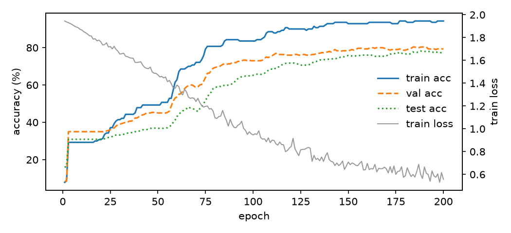

# Graph Convolutional Network from Scratch on Cora

Two-layer GCN (Kipf & Welling, 2017) for semi-supervised node classification on the Cora citation graph. The graph convolution is written by hand on a dense adjacency matrix. No PyTorch Geometric or other graph library is used.

## Problem

Cora has 2708 machine learning papers connected by 5429 citations. Each paper is a 1433-dimensional bag-of-words vector and belongs to one of 7 topics. Only **140 papers are labelled**. The task is to predict the topic of the rest, using both the words in a paper and who it cites.

Splits (by node index in `cora.content`): train 0-139, validation 200-499, test 500-1499. Every forward pass sees all 2708 nodes and all edges, and only the 140 training nodes contribute to the loss.

## The layer

Each layer mixes a node's features with its neighbours':

$$H' = \hat A H W + b, \qquad \hat A = \tilde D^{-1/2} \tilde A \tilde D^{-1/2}, \qquad \tilde A = A + I$$

Every node takes a weighted sum of $h_j W$ over itself and its neighbours, scaled by $1/\sqrt{d_i d_j}$ so high-degree nodes don't blow up the sum. Two of these layers give

$$Z = \hat A \, \text{ReLU}(\hat A X W_1) W_2$$

so each prediction depends on the node's 2-hop neighbourhood.

A few details that matter in the implementation ([model.py](model.py)):

- **Duplicate edges.** 151 citations appear in both directions in `cora.cites`, so after making the graph undirected there are 302 duplicate entries. The adjacency matrix is built by assignment instead of scatter-add, so each edge counts once.
- **Order of multiplication.** $\hat A (X W)$ instead of $(\hat A X) W$. $XW$ is $2708 \times 16$ while $X$ is $2708 \times 1433$, so this is about 90x less work.
- **Bias after aggregation.** Rows of $\hat A$ don't sum to 1, so putting the bias inside ($\hat A(XW + b)$) would scale it differently for every node.
- $\hat A$ only depends on the graph, so it is built once and cached.

Hyperparameters are the ones from the paper: hidden size 16, dropout 0.5, Adam with lr 0.01 and weight decay 5e-4, 200 full-batch epochs.

## Results

Single run, seed 42:

| | Train | Val | Test |
|---|---|---|---|
| Accuracy | 94.29% | 79.33% | 77.30% |
| Macro-F1 | 0.894 | 0.718 | 0.697 |



Learning starts slowly: test accuracy is still around 43% at epoch 60 and levels off after about 150 epochs. Macro-F1 is lower than accuracy because the small classes are predicted less reliably.

The paper reports 81.5%. The gap is most likely the split. The first 140 nodes in file order are not class balanced (14, 11, 41, 28, 21, 8, 17 per class), unlike the 20-per-class Planetoid split used in the paper.

## Ablations

Same setup, only the propagation matrix or the depth changes. Accuracy (%), mean ± std over seeds 0-9 ([ablations.py](ablations.py)):

| Variant | Train | Val | Test |
|---|---|---|---|
| Symmetric norm (default) | 96.3 ± 0.8 | 81.0 ± 1.4 | 79.5 ± 1.8 |
| No graph ($\hat A = I$, i.e. an MLP) | 100.0 ± 0.0 | 57.6 ± 1.4 | 53.2 ± 0.8 |
| No self loops | 94.3 ± 1.6 | 78.2 ± 1.9 | 76.4 ± 1.9 |
| Row norm $\tilde D^{-1} \tilde A$ | 95.5 ± 1.2 | 81.7 ± 1.3 | 81.9 ± 1.0 |
| Unnormalised $\tilde A$ | 99.9 ± 0.3 | 80.4 ± 1.1 | 81.1 ± 1.4 |
| Duplicate edges counted twice | 96.3 ± 1.0 | 80.5 ± 1.2 | 79.6 ± 1.7 |
| Depth 1 | 47.4 ± 0.3 | 39.4 ± 0.1 | 34.4 ± 0.1 |
| Depth 3 | 91.9 ± 3.8 | 73.9 ± 1.8 | 69.5 ± 4.7 |
| Depth 4 | 82.0 ± 4.6 | 63.9 ± 5.0 | 58.2 ± 6.8 |
| Depth 6 | 63.9 ± 13.0 | 52.5 ± 6.8 | 45.4 ± 7.0 |
| Depth 8 | 30.4 ± 0.8 | 34.3 ± 1.7 | 29.2 ± 1.0 |

What I took from this:

- **The graph does most of the work.** Without it the network memorises the 140 training nodes (100% train) and gets 53% on test. Aggregating over neighbours adds 26 points. Papers that cite each other are usually on the same topic, so the labels effectively spread along the edges.
- **Self loops matter, the exact normalisation not so much.** Without self loops a node's own features don't reach its first layer output (-3 points). Row normalisation and even the unnormalised matrix do as well as or slightly better than symmetric normalisation here, within 1-2 std. Counting the duplicate edges twice makes no measurable difference.
- **Two layers is the sweet spot.** One layer underfits (47% train). That's the weight decay, not a lack of capacity: without weight decay the same model gets 93% train (seed 0). From 3 layers on, accuracy drops steadily, which is what over-smoothing looks like: multiplying by $\hat A$ again and again averages the node representations until they all look alike. At depth 8 the test accuracy (29.2%) is below the 30.9% you get by always predicting the most common class.

## Run

```bash
pip install -r requirements.txt
python train.py           # ~15 s on CPU, add --plot to save training_curve.png
python ablations.py       # ~10 min on CPU
```

## Dataset

[Cora](https://linqs.org/datasets/#cora), included in `cora/`. P. Sen, G. Namata, M. Bilgic, L. Getoor, B. Gallagher, T. Eliassi-Rad, "Collective Classification in Network Data," AI Magazine, 2008.

## Reference

T. N. Kipf, M. Welling, "Semi-Supervised Classification with Graph Convolutional Networks," ICLR 2017.
