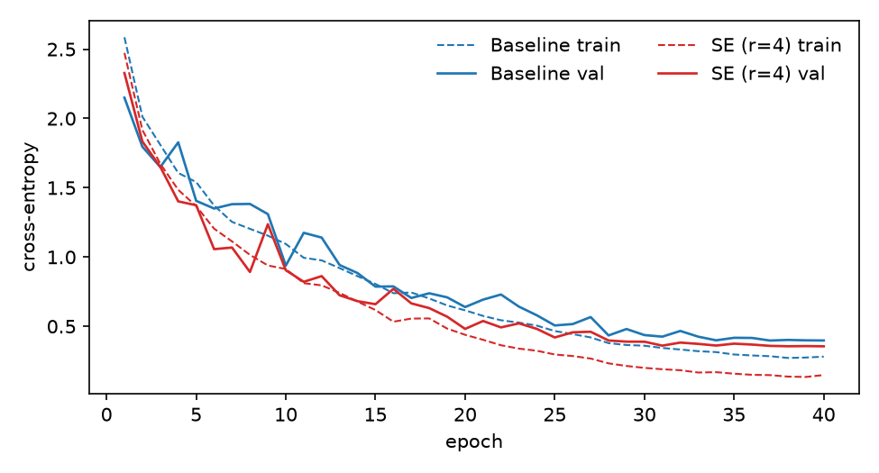
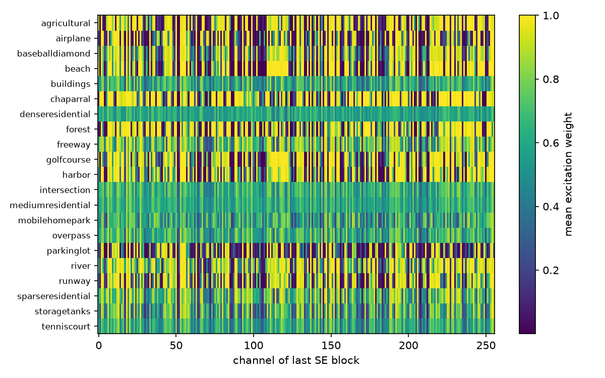

# Squeeze-and-Excitation Blocks on UC Merced Land Use

A small CNN with and without Squeeze-and-Excitation (SE) blocks (Hu et al., 2018), trained from scratch to classify aerial images into 21 land-use classes. Everything is kept identical between the two models except the SE blocks, so the comparison shows what channel attention adds on its own.

## The SE block

A conv layer produces C feature maps and treats them all as equally important, for every image. An SE block lets the network reweight the channels per image:

1. **Squeeze:** global average pool each channel to one number, $z = \text{GAP}(U) \in \mathbb{R}^C$
2. **Excite:** a small bottleneck MLP gives one weight per channel, $s = \sigma(W_2 \, \text{ReLU}(W_1 z))$, with $W_1$ of shape $C/r \times C$
3. **Scale:** multiply each feature map by its weight, $\tilde U_c = s_c U_c$

So the block looks at a summary of the whole image and decides which channels to turn up or down. $r$ is the reduction ratio of the bottleneck.

## Models

**Baseline:** 4 blocks of `conv3x3 → batchnorm → relu → maxpool` (32, 64, 128, 256 channels), then global average pooling, dropout 0.3 and a linear classifier. 394K parameters.

**SE-CNN:** the same network with an SE block after each ReLU, before pooling. 438K parameters with $r = 4$ (+11%).

See [model.py](model.py).

## Training setup

The same for every model:

- AdamW, weight decay 1e-4, batch 32, 40 epochs with a cosine schedule
- images resized to 128x128, normalised with train-set mean/std
- augmentation on train only: horizontal and vertical flips plus random 90° rotations (aerial images have no "up")
- keep the checkpoint with the lowest validation loss
- seeds 0, 1, 2. The seed fixes both the initialisation and the data order, so both models see the same batches

The learning rate was tuned **on the baseline only**, on the validation set:

| lr | 3e-4 | 1e-3 | 3e-3 | 1e-2 | 3e-2 |
|---|---|---|---|---|---|
| val acc | 86.19 | 87.14 | 89.05 | 89.05 | 85.24 |

The tie between 3e-3 and 1e-2 was broken by validation macro-F1 (0.8888 vs 0.8887, so really a coin flip). The SE models reuse 1e-2 without any tuning of their own, which if anything favours the baseline.

## Results

Test set (420 images), mean ± std over 3 seeds:

| Model | Params | Val acc | Test acc | Test macro-F1 |
|---|---|---|---|---|
| Baseline | 394,293 | 88.25 ± 0.73 | 83.33 ± 1.49 | 83.41 ± 1.41 |
| **SE, r = 4** | 438,413 | 88.41 ± 0.27 | **87.46 ± 0.50** | **87.60 ± 0.44** |
| SE, r = 2 | 482,053 | 87.78 ± 1.45 | 85.95 ± 1.86 | 86.04 ± 1.96 |
| SE, r = 8 | 416,593 | 88.73 ± 0.99 | 85.56 ± 1.31 | 85.69 ± 1.36 |

SE with $r = 4$ improves test accuracy by **4.13 points** for 11% more parameters. The gain shows up on every seed (+2.86, +5.48, +4.05), and the SE model is also more consistent across seeds (std 0.50 vs 1.49).

Validation accuracy is almost the same for both models. That is expected: the 210 validation images were used to pick each checkpoint, so they're optimistic and saturate. The test set was never used for any decision, so it's the fair comparison.



*Train (dashed) and validation (solid) loss, mean over 3 seeds.*

SE reaches a lower training loss (0.148 vs 0.281 at epoch 40) **and** a lower validation loss (0.356 vs 0.397). So it isn't just regularising more, it actually fits the data better.

**Reduction ratio.** $r = 4$ was fixed as the main setting before running anything. $r = 2$ and $r = 8$ also beat the baseline on test, and they're within one std of each other. If $r$ had been picked by validation accuracy instead, it would have been $r = 8$, which is still +2.2 points.

## What the SE blocks learn

To see whether the channel weights depend on the image content, I took the seed-0 model, averaged the excitation weights of each SE block per class on the test set, and measured how much those class averages differ across the 21 classes (std across classes, averaged over channels, divided by the mean weight):

| SE block | 1 (32 ch) | 2 (64 ch) | 3 (128 ch) | 4 (256 ch) |
|---|---|---|---|---|
| class dependence | 0.148 | 0.164 | 0.149 | 0.384 |

The first three blocks behave about the same for every class. The last block is much more class-specific. This matches what Hu et al. found on ImageNet: early SE blocks pick up general features, deeper ones specialise.



*Mean excitation weight per class for the 256 channels of the last SE block.*

There's a visible pattern in the last block. Classes defined by texture or a single dominant surface (forest, chaparral, beach, harbor, agricultural) get very decisive weights, close to 0 or 1, and each class has its own on/off pattern. The dense, mixed urban scenes (buildings, dense residential, intersection, mobile home park) get flat weights around 0.5 on almost every channel, as if the block can't find a few channels that settle the class and keeps everything.

**Cost.** The extra FLOPs are tiny, but on my laptop (Apple MPS) an SE run took about 9.7 min vs 4.2 min for the baseline. I didn't profile it. My guess is the many small extra kernels (pooling, two tiny linear layers, the rescale) in both the forward and backward pass. Run times also varied by about ±30% between seeds, so treat the ratio as rough.

## Files

- [model.py](model.py): `SEBlock` and the `CNN` (`se=False` is the baseline)
- [data.py](data.py): loaders, train-set normalisation stats, augmentation
- [train.py](train.py): trains one model and writes `results/<name>.json`
- [analysis.py](analysis.py): results table, loss curves and the SE weight analysis, from `results/`
- [run_experiments.sh](run_experiments.sh): runs everything above in order (17 runs, about 2 h on an M-series Mac)
- `results/`: the json for every run reported here and the seed-0 SE checkpoint, so `analysis.py` works without retraining
- [split.csv](split.csv): the exact train/val/test split used

## Run

```bash
pip install -r requirements.txt
python prepare_data.py /path/to/UCMerced_LandUse/Images   # builds data/ using split.csv
python train.py --model se --r 4 --lr 0.01 --seed 0       # one run
bash run_experiments.sh                                    # everything
python analysis.py                                         # just the tables and figures
```

Runs on CUDA, Apple MPS or CPU, picked automatically.

## Dataset

[UC Merced Land Use](http://weegee.vision.ucmerced.edu/datasets/landuse.html): 21 classes, 100 aerial images each, 256x256 RGB (a few are slightly smaller). Split here 70/10/20 per class.
Y. Yang, S. Newsam, "Bag-of-Visual-Words and Spatial Extensions for Land-Use Classification," ACM SIGSPATIAL 2010.

## Reference

J. Hu, L. Shen, G. Sun, "Squeeze-and-Excitation Networks," CVPR 2018.
